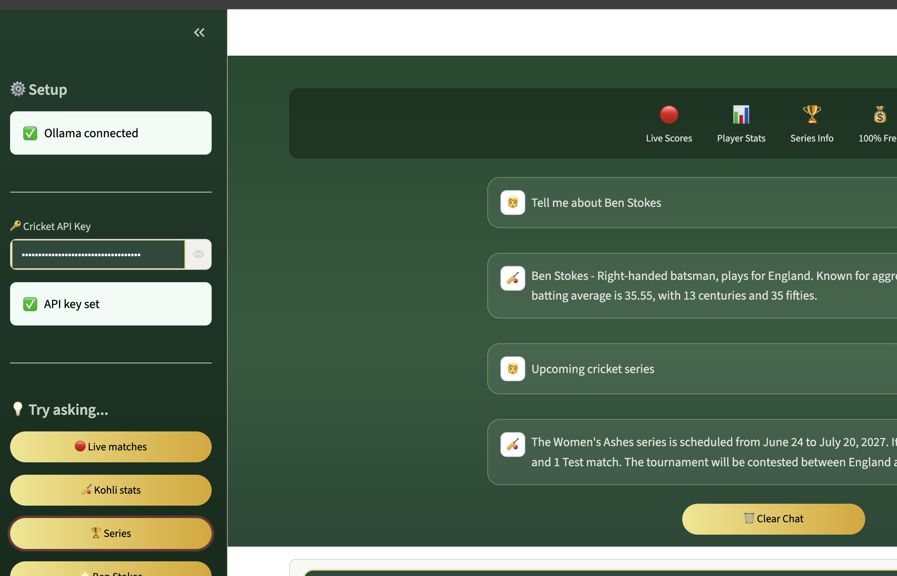
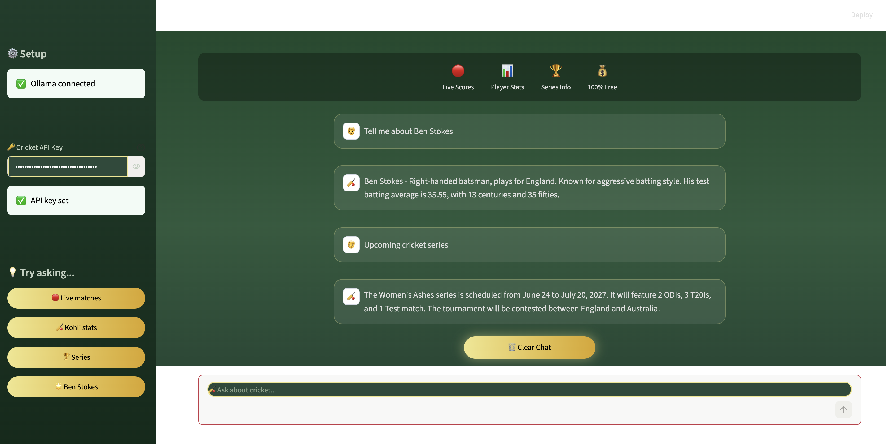

# Cricket Conversational Agent

An AI-powered conversational agent for live cricket scores, player stats, and match information. 100% free, runs locally.





## What it does

Ask natural language questions and get real-time cricket data:

```
You: What matches are live right now?

🏏 Agent: 2 live matches: India vs Australia at MCG (India 245/4, 45 overs) 
and England vs South Africa at Lord's (England 189/6, 38 overs).
```

```
You: Tell me about Virat Kohli

🏏 Agent: Virat Kohli - Right-handed batsman from India. Former captain, 
known for aggressive batting and chase master. One of the greatest 
batsmen in modern cricket.
```

```
You: Compare Kohli vs Babar Azam

🏏 Agent: Both are top-order right-handed batsmen. Kohli (India) is known 
for chasing, Babar (Pakistan) for consistency. Both are current generation greats.
```

## Features

- **Live Scores** — Current matches, scores, and status
- **Player Stats** — Career info, batting/bowling styles
- **Series Info** — Upcoming tournaments, IPL, World Cup, Ashes
- **Conversation Memory** — Remembers context for follow-ups

> **Note:** Historical match lookup by specific date requires premium API access. The free tier provides live, upcoming, and recently completed matches only.

## Architecture

```
┌──────────────────────────────────────────────┐
│          Llama 3.1 (via Ollama)              │
│      Local LLM for reasoning & response      │
└─────────────────────┬────────────────────────┘
                      │
        ┌─────────────┼─────────────┐
        ▼             ▼             ▼
  ┌──────────┐  ┌──────────┐  ┌──────────┐
  │  live    │  │  player  │  │  series  │
  │ matches  │  │  stats   │  │  info    │
  └────┬─────┘  └────┬─────┘  └────┬─────┘
       │             │             │
       └─────────────┼─────────────┘
                     ▼
             ┌──────────────┐
             │   CricAPI    │
             │  (free tier) │
             └──────────────┘
```

## Quick Start

### Prerequisites

1. **Python 3.11+** — [Download](https://www.python.org/downloads/)
2. **Ollama** — [Download](https://ollama.ai) (for local LLM)
3. **CricAPI Key** — [Get free](https://cricapi.com/) (100 requests/day)

### Step-by-Step Setup

```bash
# 1. Clone the repo
git clone https://github.com/geetu83-data/cricket-agent.git
cd cricket-agent

# 2. Create virtual environment
python3 -m venv venv
source venv/bin/activate  # Windows: venv\Scripts\activate

# 3. Install dependencies
pip install -r requirements.txt

# 4. Start Ollama (in a separate terminal)
ollama serve

# 5. Pull the LLM model (first time only, ~5GB download)
ollama pull llama3.1:8b

# 6. Set your API key and run
export CRICKET_API_KEY='your-api-key-here'  # Windows: set CRICKET_API_KEY=your-key
streamlit run app.py
```

### 7. Open in browser

Go to **http://localhost:8501** — the app will open automatically!

> **Tip:** Keep `ollama serve` running in a separate terminal while using the app.

## Example Questions

| Question | What it does |
|----------|--------------|
| "Live matches" | Shows current games with scores |
| "Virat Kohli stats" | Player career information |
| "Upcoming series" | IPL, World Cup, bilateral series |
| "Tell me about Ben Stokes" | Player lookup |

## Project Structure

```
cricket-agent/
├── agent.py           # Main agent with Ollama integration
├── tools.py           # Tool definitions
├── cricket_client.py  # CricAPI client
├── app.py             # Streamlit UI
├── requirements.txt
└── README.md
```

## Tech Stack

- **Llama 3.1** — Local LLM via Ollama (free)
- **CricAPI** — Cricket data (100 req/day free)
- **Streamlit** — Web UI
- **Python 3.11+**

## Cost

**$0** — Everything runs locally or on free tiers.

## Extending

Add new tools by:
1. Add function in `cricket_client.py`
2. Define tool schema in `tools.py`
3. Register handler in `agent.py`

Ideas:
- Historical match data
- Team rankings
- Fantasy cricket suggestions

## Author

Built by [Geetanjali Pramod](https://linkedin.com/in/geetanjalipramod) — Principal Analytics & AI Strategy at E.ON Next.

Demonstrating AI agent development with tool use, real-time API integration, and conversational interfaces.
